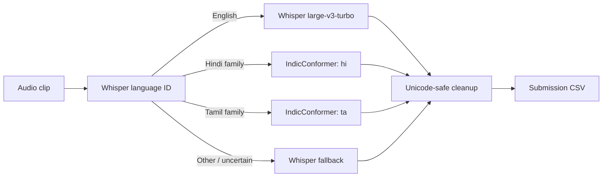

# Multilingual Speech Recognition

An applied automatic-speech-recognition project for the [NPPE-2 Multilingual Speech Recognition Challenge](https://www.kaggle.com/competitions/multilingual-speech-recognition). The repository traces the project from CPU Whisper baselines through LoRA experiments to a language-aware hybrid system for English, Hindi-family, and Tamil-family speech.

## Why this project is interesting

Word Error Rate (WER) rewards exact transcripts, so a phonetically plausible answer in the wrong script can still fail badly. The final design treats language/script selection as part of the ASR system:



The challenge data described in the project report contains **2,000 labelled training clips and 100 unlabelled test clips**, approximately spanning Latin/English, Devanagari/Hindi-family, and Tamil script groups.

## What I explored

- Zero-shot `openai/whisper-base` and `openai/whisper-small` CPU baselines.
- Beam-search decoding and conservative transcript normalization.
- Whisper-small PEFT/LoRA fine-tuning experiments.
- Script-aware train/validation splitting and raw versus cleaned WER/CER.
- Faster-Whisper language identification and cached inference.
- Routed transcription with Whisper and `ai4bharat/indic-conformer-600m-multilingual`.
- Final submission validation and preservation of Indic Unicode text.

## Start here

| File | Role |
|---|---|
| [Final routed notebook](notebooks/final_hybrid_routed_asr_notebook.ipynb) | Main Kaggle/Colab pipeline with language ID, routing, caching, validation, and submission generation |
| [Workspace final notebook](notebooks/workspace_final_hybrid_asr_notebook.ipynb) | Preserved variant of the final pipeline |
| [Safe hybrid experiment](notebooks/best_of_both_safe_hybrid.ipynb) | Whisper-small training/inference path with explicit WER and CER |
| [Hybrid Python export](scripts/colab_hybrid_whisper_indicconformer.py) | Script form of the hybrid notebook |
| [Research paper](docs/multilingual_speech_recognition_research_paper.md) | Full motivation, methods, comparison, risks, and conclusions |
| [Notebook comparison](docs/notebook_comparison.md) | Concise comparison of early baselines and fine-tuning |

The `indictts_deepfake_audio_classification_experiment` files are a related audio-classification side experiment, not part of the final transcription pipeline.

## Run the final pipeline

The notebook was designed for Kaggle or Google Colab with GPU acceleration.

### Kaggle

1. Join the competition and attach its dataset.
2. Import [`notebooks/final_hybrid_routed_asr_notebook.ipynb`](notebooks/final_hybrid_routed_asr_notebook.ipynb).
3. Select a GPU accelerator.
4. If the gated AI4Bharat model is used, add `HF_TOKEN` through Kaggle Secrets.
5. Run all cells and retrieve `/kaggle/working/submission.csv`.

### Colab

Upload and extract the competition data so the notebook can resolve:

```text
/content/competition_data/
├── train.csv
├── test.csv
└── competition_data/
    ├── train/
    └── test/
```

The notebook installs its required packages, including `faster-whisper`, `transformers`, `datasets`, `evaluate`, `jiwer`, `librosa`, and PyTorch audio packages. Model downloads require internet access and several gigabytes of disk/RAM.

## Evaluation

```text
WER = (substitutions + deletions + insertions) / reference words
```

Lower is better. The repository contains validation scaffolding and experimental notes, but it does **not** contain the hidden test references or a consistently recorded final hybrid WER. Accordingly, this README does not present an unverified final score. The committed [research paper](docs/multilingual_speech_recognition_research_paper.md) explains why the different notebook metrics are not directly comparable.

## Repository map

```text
.
├── docs/          # Research paper, working notes, notebook comparison
├── notebooks/     # Baselines, LoRA, hybrid, and side experiments
├── scripts/       # Python exports of selected notebooks
├── submissions/   # One preserved generated submission workbook
└── README.md
```

## Limitations

- Language identification errors can route an utterance to the wrong model and script.
- The training set is small for multilingual fine-tuning; one adapter may improve one script group while degrading another.
- The final system depends on large external model downloads, GPU availability, and gated Hugging Face access for AI4Bharat.
- Decoding and normalization differ across experiments, so their WER values should not be compared without rerunning them under one protocol.
- The repository does not include competition audio or a pretrained project checkpoint.
